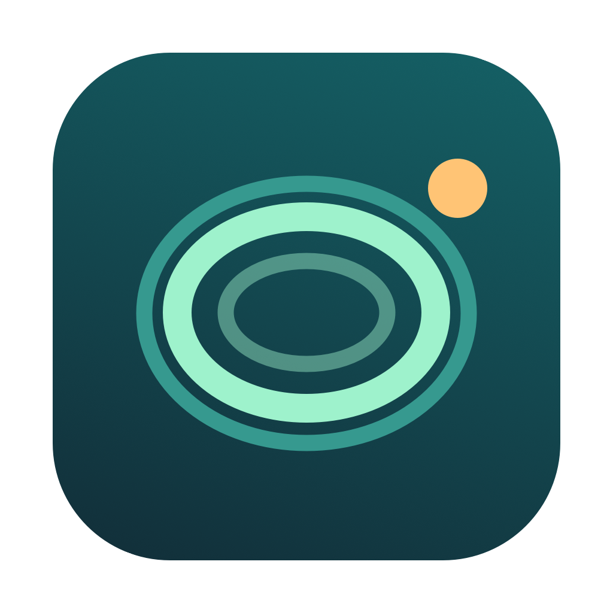

# Hole



**A native macOS toolkit by AkdenizOS.** Review cache and log files, inspect installed apps, find where disk space goes, and monitor your Mac.

[Download Hole](https://github.com/efekurucay/hole/releases/latest) · [Build from source](#build-from-source) · [Design and reverse-engineering notes](wiki/README.md)

## What it does

| Tool | Workflow |
| --- | --- |
| Cleanup | Scan user caches and logs, with optional Hugging Face and uv caches. Filter the results and confirm which items to move to Trash. |
| Applications | List installed apps and review the app bundle alongside data matched by bundle identifier. Check Homebrew update availability or open the App Store and macOS Software Update. Open Login Items in System Settings. |
| Disk explorer | Choose a folder or volume, see its largest entries as a treemap, drill into folders, and reveal items in Finder. |
| Maintenance | Check Spotlight indexing, verify the startup volume, or explicitly refresh the Quick Look thumbnail cache. |
| Live status | See CPU history, memory, available disk space, network rates, battery, thermal pressure, uptime, and the top processes by CPU. Add a compact snapshot to the menu bar in Settings. |

## Install

Hole requires macOS 14 or later. Download `Hole.dmg`, open it, and drag Hole to Applications. The release is a universal build for Apple Silicon and Intel. Community builds use ad hoc signing and macOS may block downloaded copies under Gatekeeper. Building locally is an alternative.

Cleanup and app review start with an empty selection. Hole rechecks each selected item's identity and path before moving it to Finder Trash. Scans stay on the Mac. Protected or inaccessible locations may be skipped, and allocated-size estimates can differ from the amount of space APFS actually recovers.

## Build from source

Install Xcode or the Xcode Command Line Tools, then run:

```sh
git clone https://github.com/efekurucay/hole.git
cd hole
./scripts/build.sh
open build/Hole.app
```

`./scripts/build.sh release` builds the universal app and `build/Hole.dmg`. The Homebrew update check is optional. The build has no third-party dependencies.

Run the read-only checks:

```sh
build/Hole.app/Contents/MacOS/Hole --self-test
```

The self-test creates an isolated fixture in the system temporary directory and keeps it intact. It checks scanning, app matching, file identity validation, treemap proportions, and system metrics without invoking any Trash or maintenance action.

## License and credits

MIT. Hole uses original Swift code and artwork. Its workflow is inspired by [Mole](https://github.com/tw93/Mole) by tw93. Hole is an independent project.
